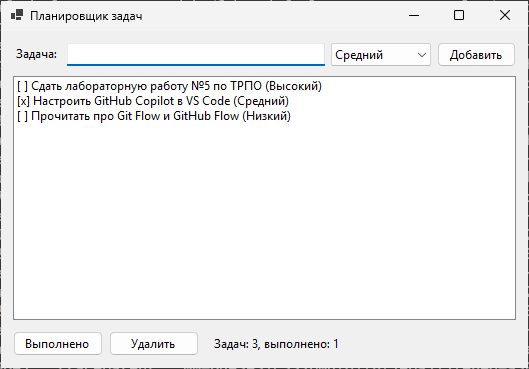
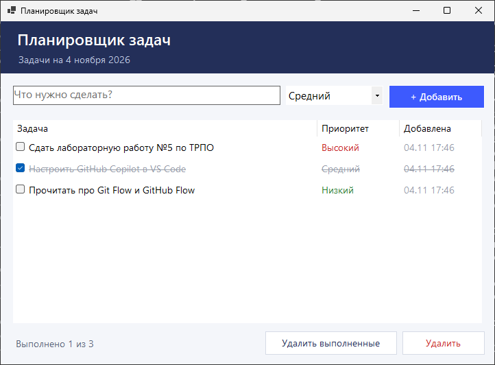

# Отчёт об использовании AI-инструментов (ЛР5)

## 1. Инструмент

**Claude (Anthropic)** в агентном режиме. В отличие от GitHub Copilot, который
подсказывает продолжение кода в редакторе построчно, агент получает задание
текстом и выполняет его целиком: пишет код, выполняет команды Git, создаёт ветку
и Pull Request, проверяет сборку через CI.

Для сравнения разобраны и другие инструменты из методички:

| Инструмент | Как работает | Где удобен |
|------------|--------------|------------|
| GitHub Copilot | Подсказки серым текстом прямо в VS Code / Visual Studio, принимаются клавишей Tab; генерация функции по комментарию | Рутинный код, тесты, дописывание по шаблону |
| ChatGPT, DeepSeek | Чат: вопрос — ответ с кодом, код переносится вручную | Объяснение ошибок, разбор незнакомого API |
| Claude (агент) | Выполняет задачу целиком в репозитории: код, коммиты, PR, проверка в CI | Законченные задачи из нескольких шагов |

## 2. Задание проекта, выполненное с помощью AI

**Редизайн главной формы** планировщика задач: ветка `feature/form-redesign`,
[Pull Request #1](https://github.com/vlasovrustam07-cpu/trpo-lab5/pull/1).

Задание для AI: сделать форму современной и удобной, не меняя логику работы
с задачами (`Models`, `Services`).

## 3. Что предлагал инструмент

- заменить абсолютные координаты элементов на `Dock` и `TableLayoutPanel`,
  чтобы форма растягивалась;
- добавить тёмную шапку с названием приложения и текущей датой;
- заменить `ListBox` со строками вида `[x] Задача (Приоритет)` на `ListView`
  с колонками «Задача», «Приоритет», «Добавлена» и флажками;
- выделять приоритет цветом, а выполненные задачи зачёркивать и делать серыми;
- подсказка в поле ввода (`PlaceholderText`), добавление задачи по Enter
  (`AcceptButton`);
- кнопка «Удалить выполненные» и счётчик «Выполнено N из M» в нижней панели;
- колонка «Задача» растягивается на всю свободную ширину при изменении размера окна.

## 4. Насколько предложения были полезны

**Полезно.** За один шаг получен рабочий код формы: разметка в
`Form1.Designer.cs` в формате конструктора Visual Studio и логика в `Form1.cs`.
Сборка прошла с первого раза без предупреждений
([прогон 41878587492](https://github.com/vlasovrustam07-cpu/trpo-lab5/actions/runs/41878587492)).
Логику (`TaskManager`, `TaskItem`) менять не пришлось — AI учёл разделение на слои.

**Ограничения.** Агент работал в среде без Windows и не мог сам запустить
Windows Forms. Чтобы проверить внешний вид, в CI добавлен шаг, который собирает
приложение на `windows-latest`, запускает его и делает снимок окна
(`.github/scripts/screenshot.ps1`).

По первому снимку найдены два недочёта, которые AI не предусмотрел:

1. В `Form1.Designer.cs` значение `AutoScaleDimensions` не соответствовало шрифту
   Segoe UI 10 pt, поэтому форма автоматически уменьшалась: окно 632×479 вместо
   задуманного размера.
2. При запуске фокус получало поле ввода, поэтому подсказка «Что нужно сделать?»
   не отображалась.

## 5. Как был доработан или принят код

- Недочёты исправлены отдельным коммитом `085cd51` в той же ветке:
  `AutoScaleDimensions = new SizeF(7F, 17F)` и стартовый фокус на списке задач.
  Повторная сборка и снимок
  ([прогон 41880242767](https://github.com/vlasovrustam07-cpu/trpo-lab5/actions/runs/41880242767)):
  окно 722×532, подсказка видна.
- Изменения просмотрены на вкладке **Files changed** Pull Request и влиты в `main`
  только после зелёной сборки.
- Код не принимался вслепую: каждое изменение прошло сборку, визуальную
  проверку по снимку и Pull Request.

| До | После |
|---|---|
|  |  |

## 6. Вывод

AI-инструмент заметно ускоряет рутинную часть работы: разметку формы, обработчики
событий, оформление. Но результат нужно проверять так же, как код коллеги:
запускать, смотреть на экран и читать изменения. В этой работе проверка по снимку
окна нашла две ошибки, которые без запуска программы остались бы незамеченными.
