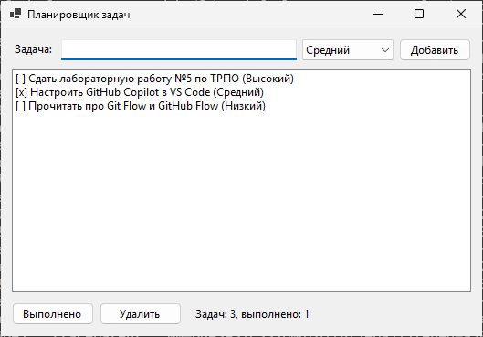
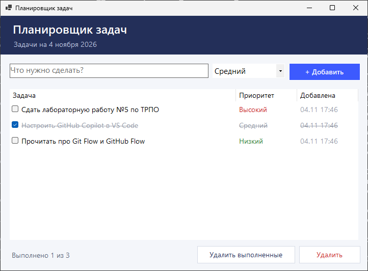

# TaskPlanner — ЛР5: AI-инструменты, ветки и Pull Request

[](https://github.com/vlasovrustam07-cpu/trpo-lab5/actions/workflows/build.yml)

Планировщик задач на C# (Windows Forms, .NET 8): добавление задач с приоритетом,
отметка о выполнении, удаление выполненных, счётчик «Выполнено N из M».
Задачи хранятся в памяти.

Редизайн главной формы выполнен с помощью AI-инструмента в ветке
`feature/form-redesign` и влит в `main` через
[Pull Request #1](https://github.com/vlasovrustam07-cpu/trpo-lab5/pull/1).
Как применялся AI — в [AI_REPORT.md](AI_REPORT.md).

## Скриншоты

| До (ветка `main` до PR) | После (`feature/form-redesign`) |
|---|---|
|  |  |

Снимки сделаны автоматически в GitHub Actions на `windows-latest`
(скрипт [`.github/scripts/screenshot.ps1`](.github/scripts/screenshot.ps1)).

## Архитектура

```text
trpo-lab5/
├── .github/
│   ├── workflows/build.yml       # CI: сборка на Windows и снимок главной формы
│   └── scripts/screenshot.ps1    # запуск приложения и снимок окна
├── docs/screenshots/             # снимки формы до и после редизайна
├── TaskPlanner.sln
└── TaskPlanner/
    ├── Program.cs                # точка входа
    ├── Form1.cs                  # логика формы: обработчики, отображение списка
    ├── Form1.Designer.cs         # разметка формы (конструктор Visual Studio)
    ├── Models/
    │   ├── TaskItem.cs           # задача: название, приоритет, выполнена, дата
    │   └── TaskPriority.cs       # приоритет: низкий, средний, высокий
    └── Services/
        └── TaskManager.cs        # список задач: добавление, удаление, подсчёт
```

Слои разделены: модель (`Models`) ничего не знает о форме, логика работы со
списком собрана в `TaskManager`, а форма только отображает данные и передаёт
действия пользователя в `TaskManager`.

## Текущее состояние

- [x] добавление задачи с приоритетом (кнопка или Enter), пустое название не принимается;
- [x] отметка о выполнении флажком, выполненные задачи зачёркнуты;
- [x] удаление выбранных задач и всех выполненных;
- [x] счётчик выполненных задач;
- [x] форма растягивается, колонки подстраиваются под ширину окна;
- [ ] сохранение задач в файл (задачи пока хранятся только в памяти).

## Запуск

Открыть `TaskPlanner.sln` в Visual Studio 2022 и нажать **F5**
или из командной строки на Windows:

```bash
dotnet run --project TaskPlanner
```

## Работа с ветками и Pull Request

```text
$ git checkout -b feature/form-redesign
Switched to a new branch 'feature/form-redesign'
$ git add .
$ git commit -m "Обновил внешний вид формы"
[feature/form-redesign 568ff7a] Обновил внешний вид формы
 2 files changed, 331 insertions(+), 83 deletions(-)
$ git push -u origin feature/form-redesign
 * [new branch]      feature/form-redesign -> feature/form-redesign
```

Затем на GitHub создан [Pull Request #1](https://github.com/vlasovrustam07-cpu/trpo-lab5/pull/1)
(`base: main` ← `compare: feature/form-redesign`), изменения проверены на вкладке
**Files changed**, сборка в CI прошла успешно, выполнены **Merge pull request →
Confirm merge**.

## Описание коммитов

```text
$ git log --oneline --graph
*   e5ca202 Merge pull request #1 from vlasovrustam07-cpu/feature/form-redesign
|\
| * b28d604 README, отчёт об использовании AI и скриншоты формы до и после
| * 085cd51 Форма: исправлен масштаб под шрифт Segoe UI 10 pt, видна подсказка в поле ввода
| * 568ff7a Обновил внешний вид формы
|/
* e5d7997 CI: снимок по видимой рамке окна, upload-artifact v6
* 1720074 CI: снимок формы дублируется в лог, actions обновлены до v5 (Node.js 24)
* d39001d Сборка в GitHub Actions на Windows и снимок главной формы
* aebf508 Первая версия планировщика задач (Windows Forms)
```

| Коммит | Что сделано |
|--------|-------------|
| `aebf508` | Первая версия приложения: модель задачи, `TaskManager`, простая форма со списком |
| `d39001d` | CI в GitHub Actions: сборка на Windows и снимок главной формы |
| `1720074` | Снимок формы выводится в лог CI, actions обновлены до v5 |
| `e5d7997` | Снимок по видимой рамке окна, `upload-artifact` v6 |
| `568ff7a` | Редизайн формы (выполнен с помощью AI) |
| `085cd51` | Исправления по итогам проверки снимка: масштаб формы и подсказка в поле ввода |
| `b28d604` | README, отчёт об использовании AI, скриншоты до и после |
| `e5ca202` | Слияние ветки `feature/form-redesign` в `main` |
